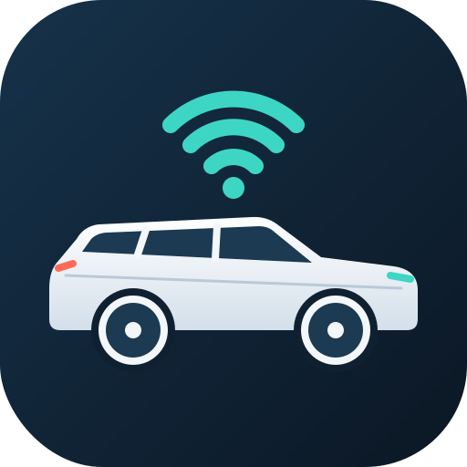

<p align="center">
  
</p>

[](https://hacs.xyz/)
[](https://github.com/rossserven/ha-hondalink/releases)
[](LICENSE)
[](https://github.com/rossserven/ha-hondalink)

# HondaLink and AcuraLink for Home Assistant

Unofficial Home Assistant custom integration for HondaLink MY21 telematics vehicles, with added AcuraLink support.

> **This is a fork** of [daviddelahoz/ha-hondalink](https://github.com/daviddelahoz/ha-hondalink) by David De La Hoz, which this project is built on. It adds AcuraLink support and an options-flow fix for current Home Assistant versions. The AcuraLink changes are also offered upstream in [daviddelahoz/ha-hondalink#13](https://github.com/daviddelahoz/ha-hondalink/pull/13); if they are merged there, this fork may be retired in favor of the original.

This integration uses the HondaLink Android app API flow, observed while debugging the app, to discover vehicles, poll vehicle state, and expose supported remote commands in Home Assistant.

> This project is not affiliated with, endorsed by, or supported by Honda. HondaLink is a trademark of its respective owner.

## Features

- Fuel level, range, odometer, oil life, 12V battery status, tire pressure, vehicle speed, and last update sensors
- Door, hood, trunk, window, lights, warning lamp, and remote engine binary sensors
- Lock and unlock entity for supported vehicles
- Buttons for engine start, engine stop, horn, lights, stop horn/lights, and refresh
- Device tracker from vehicle GPS data when returned by the HondaLink API
- Configurable lock and unlock command codes for vehicles or markets that use alternate CIG command names

## Status

This is early custom-component work built from a validated HondaLink Android app flow observed during app debugging. It has been tested against a MY21 HondaLink telematics flow, but Honda can change these private endpoints at any time.

## AcuraLink

Choose **AcuraLink** as the brand during setup to use an Acura account. This uses the AcuraLink Android app's client credentials, headers and refresh filters.

On newer (2GX) vehicles the results of a refresh or remote command are not available from the REST results endpoint used for HondaLink; the app receives them over an AWS IoT MQTT channel. For Acura accounts the integration opens that channel (`paho-mqtt`) so that:

- The Refresh button returns live data (lock state, doors, windows, lights, tire pressure, fuel range) instead of only the vehicle's last cached upload.
- Lock, unlock, and other remote commands report their real result.
- If the channel cannot be opened the integration falls back to the REST behavior and the cached data.

Acura accounts also get an **Update location** button, which sends the app's Locate request. The location is not requested automatically; press the button (or call it from an automation) when you want a fresh position.

Tested on a 2023 Acura MDX and a 2022 Acura RDX. Engine start/stop, horn, lights, and the 12V battery sensor have not been verified on Acura vehicles.

After installing or updating, **restart Home Assistant** (a reload is not enough). The integration now depends on `paho-mqtt` 2.x, which needs Home Assistant 2025.3 or newer, and the **Brand** option only appears in the setup form after a restart.

The lock and door states come from the last live refresh. If the vehicle is locked or unlocked another way (key fob, the app), Home Assistant shows the new state after the next Refresh.

## Installation

### HACS

This repository is ready for HACS custom repository installation.

1. In Home Assistant, open HACS.
2. Open the menu (top right) and choose **Custom repositories**.
3. Add `https://github.com/rossserven/ha-hondalink` with category **Integration**.
4. Install **HondaLink & AcuraLink**.
5. Restart Home Assistant (a reload is not enough).

#### Switching from the original repository

This fork uses the same `hondalink` integration domain, so only one of the two can be installed. Your existing setup and entities carry over.

1. In HACS, remove the `daviddelahoz/ha-hondalink` repository (this removes its files; your configured integration stays in Home Assistant).
2. Add and install this repository as above.
3. Restart Home Assistant.

HondaLink (Honda) accounts have not been tested with this fork. Users of the original integration have reported 401 errors after Honda's HondaLink 5.5.0 app update; a proposed fix is in [daviddelahoz/ha-hondalink#5](https://github.com/daviddelahoz/ha-hondalink/pull/5) and is not included here.

### Manual

Copy the integration folder to Home Assistant:

```text
/config/custom_components/hondalink
```

Then restart Home Assistant.

## Setup

In Home Assistant, go to:

```text
Settings > Devices & services > Add integration > HondaLink & AcuraLink
```

The config flow asks for:

- Brand: **HondaLink** or **AcuraLink**
- Email and password for that app's account
- Remote PIN, the same one you use for remote commands in the app
- VIN, optional if the vehicle can be discovered automatically
- Name, optional display name

If auto-discovery returns no vehicles, enter the VIN manually.

## API Flow

HondaLink and AcuraLink use the same backend with different app credentials. The integration follows this sequence:

1. Register app client with HIDAS.
2. Generate a HIDAS bearer token.
3. Discover vehicles from `GET /REST/NGT/MyVehicle/1.0`.
4. Poll latest vehicle state from `POST /REST/NGT/CIG/dbd/latest/{VIN}`.
5. Send remote CIG commands through `POST /REST/NGT/CIG/{engine}/async/{command}`.
6. Poll command results from `GET /REST/NGT/CIG/{engine}/results/{request_id}`, or, for AcuraLink on 2GX vehicles, receive them over the AWS IoT push channel (see [AcuraLink](#acuralink)).

### Token Generation

The live HIDAS token endpoint expects these form fields:

```text
username=<email>
password=<password>
description=Android
client_reg_key=<client_reg_key>
```

Earlier app-debugging notes may mention `email` and `device_description`, but those fields are not the confirmed working request shape for the live endpoint.

## Options

After setup, open the integration options to change:

- Remote PIN
- Polling interval
- Lock command code
- Unlock command code

The default lock command is `alk`; the default unlock command is `dulk`.

## Troubleshooting

### Could not connect

Restart Home Assistant after updating the custom component, then try setup again. The config flow logs the HondaLink response in a redacted form, so check Home Assistant logs for:

```text
HondaLink connection failed during config flow
```

### Invalid credentials or remote PIN

Confirm that the same email, password, and remote PIN work in the HondaLink or AcuraLink mobile app, and that the Brand you chose matches it. Some accounts may require accepting updated terms or completing account verification in the app before API login succeeds.

### No vehicle discovered

Enter the VIN manually in the setup form. The integration will still try to fetch vehicle details by VIN after login.

## Security

- This integration stores your account email, password, and remote PIN in the Home Assistant config entry so it can re-authenticate after token expiry.
- The `CLIENT_ID` and `CLIENT_SECRET` values are app-level credentials observed from the HondaLink and AcuraLink mobile app flows, not user-specific credentials. Honda ships and uses them as part of the mobile app authentication flow, which this integration mirrors.
- Honda may rotate or revoke those app-level credentials at any time. If that happens, authentication can stop working for all users until the integration is updated.
- Do not share logs or diagnostics that include tokens, remote PIN, VIN, or GPS coordinates.
- Remote commands can physically affect your vehicle. Use this only with your own account and vehicle.

## Support

To support David De La Hoz, author of the original HondaLink integration this fork is built on:

<a href="https://www.buymeacoffee.com/daviddelahoz" target="_blank"></a>

## Known Limitations

- HondaLink: tested by the original author against a MY21 telematics flow; not tested with this fork.
- AcuraLink: tested on a 2023 MDX and a 2022 RDX. Engine start/stop, horn, lights, and the 12V battery sensor are unverified.
- US accounts only. The integration uses the US apps' credentials and endpoints.
- EV fields are exposed only when the Honda dashboard payload returns actual values.
- Lock and unlock command behavior may vary by vehicle, subscription, market, or Honda API changes.
- HondaLink and AcuraLink use a private cloud API; reliability depends on Honda's service and endpoint compatibility.

## Local Development

Useful validation commands:

```bash
python -m py_compile *.py
```

HACS and hassfest workflow files are included under `.github/workflows/`.
